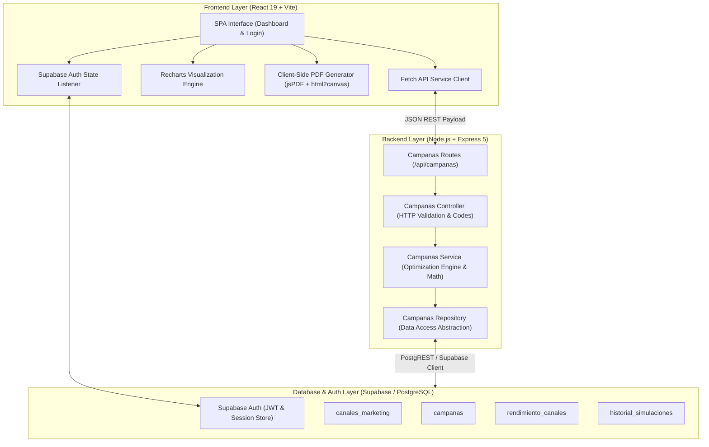
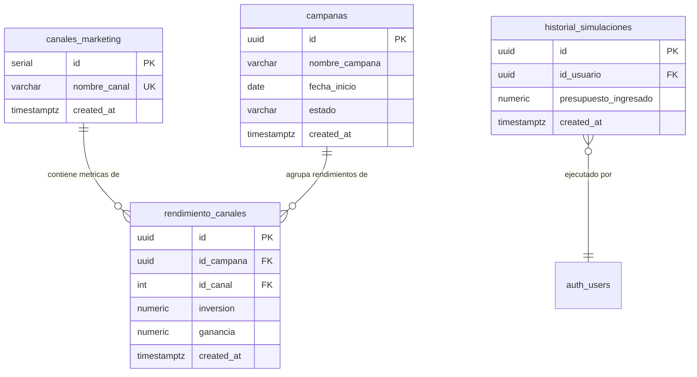
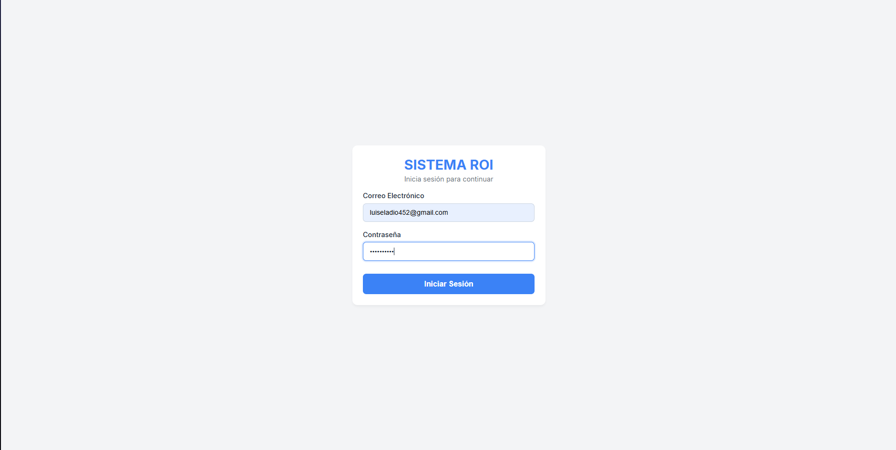
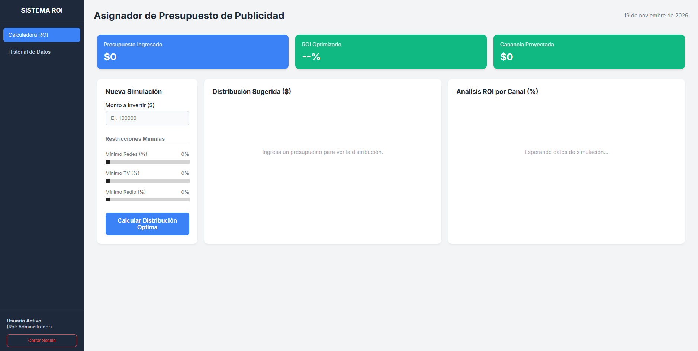
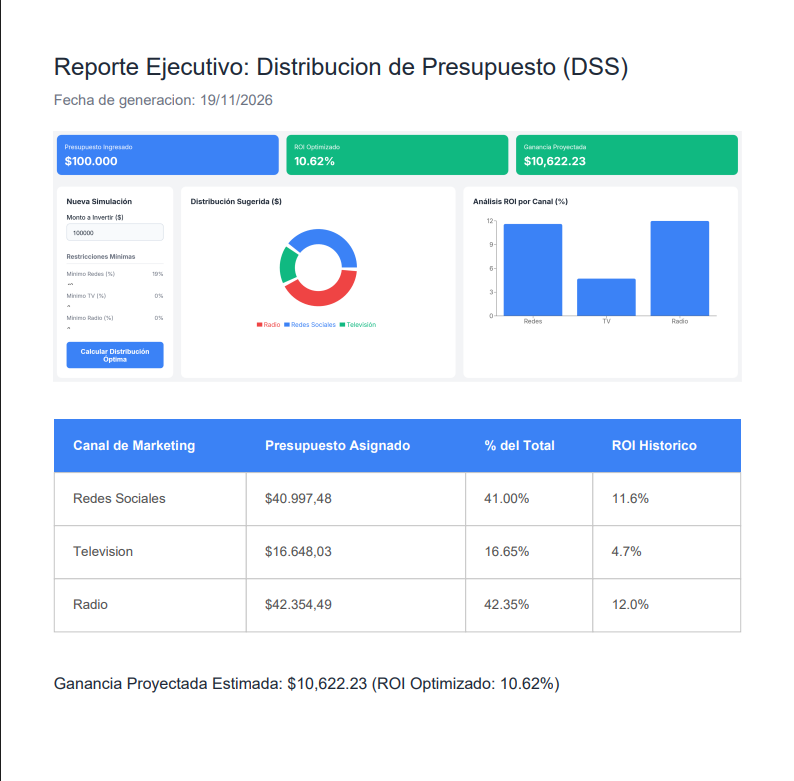
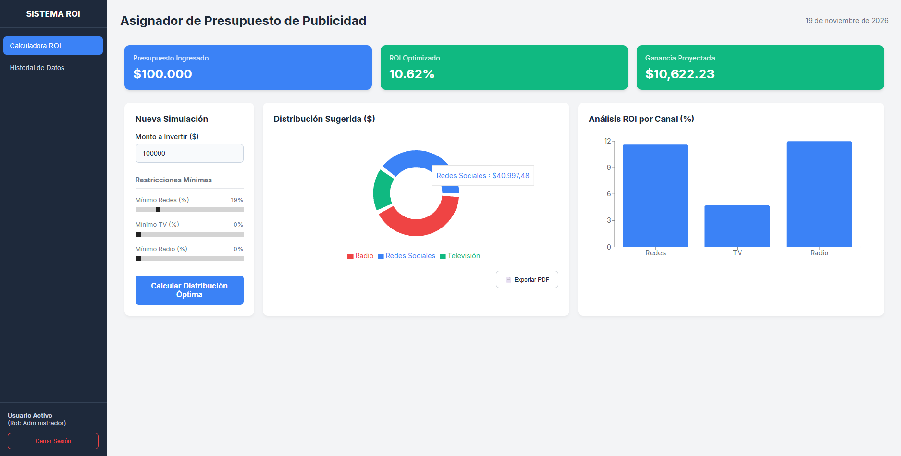
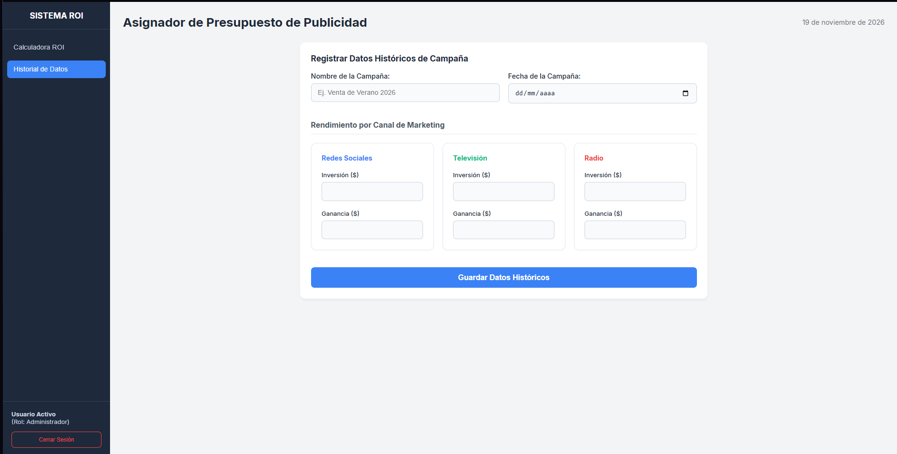

# Marketing Mix & Budget Optimizer DSS (Sistema de Optimización de ROI)

[](https://github.com/Eladio1234)
[](https://react.dev/)
[](https://expressjs.com/)
[](https://nodejs.org/)
[](https://supabase.com/)
[](https://vitejs.dev/)
[](./backend-roi/package.json)

> **Sistema de Soporte a la Decisión (DSS)** full-stack diseñado para maximizar el retorno de inversión publicitaria mediante un motor de optimización matemática con restricciones dinámicas, analítica interactiva y generación de reportes ejecutivos en PDF.

---

## 📌 Tabla de Contenidos

- [Contexto del Problema](#-contexto-del-problema)
- [Solución Técnica Implementada](#-solución-técnica-implementada)
- [Arquitectura del Sistema](#-arquitectura-del-sistema)
- [Modelo Matemático de Optimización](#-modelo-matemático-de-optimización)
- [Stack Tecnológico](#-stack-tecnológico)
- [Modelo de Base de Datos](#-modelo-de-base-de-datos)
- [Características Principales](#-características-principales)
- [Galería Visual y Flujo de Pantallas](#-galería-visual-y-flujo-de-pantallas)
- [Instalación y Configuración Local](#-instalación-y-configuración-local)
- [Endpoints de la API](#-endpoints-de-la-api)
- [Autor y Contacto](#-autor-y-contacto)

---

## 🎯 Contexto del Problema

En la gestión publicitaria corporativa y departamentos de marketing tradicional/digital, la asignación presupuestaria entre canales (**Redes Sociales**, **Televisión** y **Radio**) se realiza frecuentemente de manera empírica, reactiva o basada en sesgos subjetivos. Esta falta de modelado analítico genera:

1. **Suboptimización del Capital:** Inversión desproporcionada en canales con rendimientos decrecientes o ROI marginal bajo.
2. **Incapacidad de Absorber Restricciones Operativas:** Los modelos teóricos ignoran restricciones contractuales mínimas (e.g., compromisos de pauta negociados previamente en TV o cuotas mínimas de presencia en Redes).
3. **Falta de Trazabilidad y Proyección:** Ausencia de un repositorio centralizado de rendimiento histórico y simulaciones auditables para comités ejecutivos.

---

## 💡 Solución Técnica Implementada

El **Sistema ROI (Marketing Mix DSS)** desacopla la persistencia, el procesamiento analítico y la capa de presentación para entregar una herramienta cuantitativa de toma de decisiones:

- **Ingesta y Normalización Histórica:** Registro granular de campañas y métricas financieras de inversión versus retorno por canal en una base de datos relacional PostgreSQL (vía Supabase).
- **Motor de Optimización con Restricciones y Redistribución de Déficit:** Algoritmo que calcula el ROI histórico ponderado de cada canal, aplica las cotas mínimas porcentuales seleccionadas por el tomador de decisiones y redistribuye cualquier déficit presupuestario proporcionalmente entre los canales donadores con mejor desempeño.
- **Visualización en Tiempo Real:** Métricas clave (Presupuesto Total, ROI Estimado Ponderado y Ganancia Proyectada) renderizadas con Recharts (distribución donut y barras de ROI).
- **Síntesis Ejecutiva en PDF:** Exportación automatizada de reportes formales listos para directorio, sintetizando gráficos vectoriales (`html2canvas`) y tablas de distribución auditadas (`jspdf` + `jspdf-autotable`).

---

## 🏛 Arquitectura del Sistema

El proyecto implementa una arquitectura desacoplada basada en capas, asegurando alta cohesión, bajo acoplamiento y facilidad de testing:



### Justificación de Decisiones Técnicas

* **Patrón Controller-Service-Repository en Backend:** Aísla la lógica matemática de optimización presupuestaria del transporte HTTP y del cliente de datos. Si la base de datos cambia o se migra de Supabase a otro ORM, la capa de servicio (`campanas.service.js`) permanece inalterada.
* **Express 5.2.1 con Soporte Nativo de Async/Await:** Manejo simplificado de promesas y captura nativa de errores asíncronos sin requerir middlewares wrappers redundantes.
* **Generación Client-Side de Reportes PDF:** Alivia la carga computacional del servidor delegando el renderizado de gráficos y tablas a las librerías `html2canvas` y `jsPDF` en el navegador del cliente.
* **Sesión Reactiva con Supabase Auth:** Escucha eventos de ciclo de vida (`onAuthStateChange`) garantizando sincronización en tiempo real entre el estado de autenticación y el ruteo protegido con `react-router-dom` v7.

---

## 📐 Modelo Matemático de Optimización

El núcleo algorítmico del sistema opera bajo la siguiente formulación:

### 1. Cálculo de ROI Histórico por Canal ($c$)
Dado el conjunto de registros históricos para cada canal publicitario $c \in \{\text{Redes}, \text{TV}, \text{Radio}\}$:

$$\text{ROI}_c = \max\left(0, \frac{\sum \text{Ganancia}_c - \sum \text{Inversión}_c}{\sum \text{Inversión}_c}\right)$$

*Si un canal reporta ROI neto negativo, el algoritmo lo ajusta a $0$ para mitigar riesgo de capital.*

### 2. Asignación Proporcional Inicial
Con un presupuesto total ingresado $P_{\text{total}}$ y la sumatoria de puntos ROI $S = \sum_{c} \text{ROI}_c$:

$$A_c = \left(\frac{\text{ROI}_c}{S}\right) \times P_{\text{total}}$$

### 3. Restricciones Mínimas y Rebalanceo por Déficit
El usuario estipula cuotas mínimas porcentuales $M_c \in [0, 100]$ sujetas a $\sum M_c \le 100\%$. La cuota monetaria mínima requerida es:

$$\text{MinReq}_c = \left(\frac{M_c}{100}\right) \times P_{\text{total}}$$

Si la asignación proporcional $A_c$ es inferior a la cuota mínima obligatoria ($A_c < \text{MinReq}_c$):
1. Se fija la asignación al mínimo: $A_c = \text{MinReq}_c$.
2. Se acumula el déficit generado: $\Delta = \sum (\text{MinReq}_c - A_c)$.
3. El déficit se absorbe descontándolo de los canales donadores (aquellos con $A_d \ge \text{MinReq}_d$) en proporción a su peso de ROI relativo:

$$A_d \leftarrow A_d - \left(\Delta \times \frac{\text{ROI}_d}{\sum_{k \in \text{Donadores}} \text{ROI}_k}\right)$$

Garantizando siempre que $A_d \ge \text{MinReq}_d$ y que $\sum_{c} A_c = P_{\text{total}}$.

---

## 💻 Stack Tecnológico

### Frontend
| Tecnología | Versión | Propósito / Rol |
| :--- | :--- | :--- |
| **React** | `19.2.4` | Biblioteca UI para interfaces reactivas y componentes funcionales. |
| **Vite** | `8.0.4` | Bundler y entorno de desarrollo ultra-rápido con HMR. |
| **React Router DOM** | `7.15.1` | Gestión declarativa de rutas y navegación protegida por sesión. |
| **Recharts** | `3.8.1` | Renderizado de visualizaciones analíticas (Donut & Bar Charts). |
| **jsPDF & jsPDF-AutoTable**| `4.2.1` / `5.0.8` | Síntesis programática de documentos PDF ejecutivos en el cliente. |
| **html2canvas** | `1.4.1` | Rasterización de componentes visuales para su inclusión en reportes. |
| **Vanilla CSS Tokens** | Custom | Sistema de diseño basado en Custom Properties CSS sin dependencias pesadas. |

### Backend
| Tecnología | Versión | Propósito / Rol |
| :--- | :--- | :--- |
| **Node.js** | `>= 18.0.0` | Entorno de ejecución en servidor en modo ES Modules (`"type": "module"`). |
| **Express.js** | `5.2.1` | Framework web minimalist para endpoints RESTful y middleware. |
| **CORS** | `2.8.6` | Control de acceso HTTP y habilitación de intercambio de recursos cruzados. |
| **Dotenv** | `17.4.1` | Inyección segura de variables de entorno de configuración. |

### Base de Datos & Autenticación
| Tecnología | Proveedor | Propósito / Rol |
| :--- | :--- | :--- |
| **PostgreSQL** | Supabase Cloud | Base de datos relacional para almacenamiento de campañas y métricas. |
| **Supabase Auth** | Supabase Identity | Gestión segura de identidad de usuarios, JWT y sesiones persistentes. |

---

## 🗄 Modelo de Base de Datos

Diagrama entidad-relación de las tablas gestionadas en PostgreSQL:



---

## ⚡ Características Principales

- 🔐 **Autenticación con Guardas de Ruta:** Flujo de acceso blindado mediante Supabase Auth; redirección inteligente entre `/` y `/dashboard` según el estado de la sesión activa.
- 🧮 **Simulador Presupuestario Inteligente:** Entrada libre de presupuestos con sliders dinámicos para fijar límites mínimos operativos en canales específicos.
- ⚖️ **Motor de Rebalanceo Automático:** Ajuste de cuotas sin violar la suma total del presupuesto disponible.
- 📊 **Panel de KPIs Financieros:**
  - **Presupuesto Ingresado:** Cifra base formateada en moneda.
  - **ROI Optimizado:** Porcentaje global proyectado ponderado por canal.
  - **Ganancia Proyectada:** Retorno neto estimado en dólares/pesos según rendimientos acumulados.
- 📈 **Visualizaciones Dinámicas:** Gráfica de distribución de presupuesto por canal (Donut) y gráfica comparativa de ROI histórico porcentual (Bar).
- 📑 **Generador de Reportes Ejecutivos en PDF:** Descarga con un solo clic de un informe formal que integra la captura gráfica del dashboard, metadatos temporales y tabla detallada con porcentajes y montos asignados.
- 📝 **Módulo de Ingesta de Campañas Históricas:** Formulario para registrar nuevas campañas y rendimientos financieros mensuales por canal, alimentando continuamente el motor predictivo.

---

## 🖼 Galería Visual y Flujo de Pantallas

> *Las capturas a continuación reflejan el flujo completo de la aplicación en producción.*

### 1. Pantalla de Acceso y Autenticación
Vista de control de acceso para administradores y analistas de marketing.



---

### 2. Panel Principal: Simulación y Asignación de Presupuesto
Tablero de control con métricas KPI, sliders de restricciones mínimas y gráficos de distribución.



---

### 3.1. Reporte Ejecutivo Exportado (PDF)
Documento formal generado automáticamente listo para su entrega a comités de dirección.



---

### 3.2. Reporte en el dashboard
Muestra de las metricas en la pantalla del dashboard



---

### 4. Ingesta de Métricas y Rendimiento Histórico
Formulario estructurado para añadir campañas finalizadas y enriquecer el histórico de datos.



---

## 🛠 Instalación y Configuración Local

Sigue estos pasos para clonar, configurar y ejecutar el proyecto en tu máquina local:

### 1. Prerrequisitos
- **Node.js** (versión 18 o superior)
- Gestor de paquetes **npm** o **pnpm**
- Cuenta gratuita en [Supabase](https://supabase.com/) con un proyecto activo

---

### 2. Clonación del Repositorio
```bash
git clone https://github.com/Eladio1234/poke-api.git sistema-roi
cd sistema-roi
```

---

### 3. Configuración de la Base de Datos (Supabase)
Accede al **SQL Editor** de tu panel de Supabase y ejecuta el script DDL provisto en `backend-roi/schema.sql`:

```sql
-- Crear tabla de canales
CREATE TABLE IF NOT EXISTS canales_marketing (
    id SERIAL PRIMARY KEY,
    nombre_canal VARCHAR(100) NOT NULL UNIQUE,
    created_at TIMESTAMPTZ DEFAULT NOW()
);

-- Semillar canales
INSERT INTO canales_marketing (id, nombre_canal) VALUES
    (1, 'Redes Sociales'),
    (2, 'Televisión'),
    (3, 'Radio')
ON CONFLICT (id) DO UPDATE SET nombre_canal = EXCLUDED.nombre_canal;

-- Crear tabla de campañas
CREATE TABLE IF NOT EXISTS campanas (
    id UUID PRIMARY KEY DEFAULT gen_random_uuid(),
    nombre_campana VARCHAR(255) NOT NULL,
    fecha_inicio DATE NOT NULL,
    estado VARCHAR(50) DEFAULT 'Completada',
    created_at TIMESTAMPTZ DEFAULT NOW()
);

-- Crear tabla de rendimiento
CREATE TABLE IF NOT EXISTS rendimiento_canales (
    id UUID PRIMARY KEY DEFAULT gen_random_uuid(),
    id_campana UUID NOT NULL REFERENCES campanas(id) ON DELETE CASCADE,
    id_canal INT NOT NULL REFERENCES canales_marketing(id) ON DELETE RESTRICT,
    inversion NUMERIC(12, 2) NOT NULL CHECK (inversion >= 0),
    ganancia NUMERIC(12, 2) NOT NULL CHECK (ganancia >= 0),
    created_at TIMESTAMPTZ DEFAULT NOW()
);

-- Crear tabla de historial de simulaciones
CREATE TABLE IF NOT EXISTS historial_simulaciones (
    id UUID PRIMARY KEY DEFAULT gen_random_uuid(),
    id_usuario UUID NOT NULL,
    presupuesto_ingresado NUMERIC(14, 2) NOT NULL CHECK (presupuesto_ingresado > 0),
    created_at TIMESTAMPTZ DEFAULT NOW()
);
```

---

### 4. Configuración del Backend

1. Navega al directorio del backend:
   ```bash
   cd backend-roi
   ```
2. Instala las dependencias:
   ```bash
   npm install
   ```
3. Crea el archivo `.env` basado en la plantilla:
   ```bash
   cp .env.example .env
   ```
4. Define tus variables en `backend-roi/.env`:
   ```env
   PORT=3000
   SUPABASE_URL=https://TU_PROYECTO.supabase.co
   SUPABASE_KEY=TU_SUPABASE_SERVICE_OR_ANON_KEY
   ```
5. Inicia el servidor en modo desarrollo:
   ```bash
   npm run dev
   ```
   *El servidor quedará escuchando en `http://localhost:3000`.*

---

### 5. Configuración del Frontend

1. En una nueva terminal, navega al directorio del frontend:
   ```bash
   cd frontend-roi
   ```
2. Instala las dependencias:
   ```bash
   npm install
   ```
3. Crea el archivo `.env` basado en la plantilla:
   ```bash
   cp .env.example .env
   ```
4. Configura tus variables en `frontend-roi/.env`:
   ```env
   VITE_SUPABASE_URL=https://TU_PROYECTO.supabase.co
   VITE_SUPABASE_KEY=TU_SUPABASE_ANON_KEY
   ```
5. Inicia la aplicación en Vite:
   ```bash
   npm run dev
   ```
   *Abre tu navegador en `http://localhost:5173` (o el puerto asignado por Vite).*

---

## 📡 Endpoints de la API

La API REST expuesta por el servidor Express incluye los siguientes puntos de acceso:

| Método | Endpoint | Descripción | Body Requerido (JSON) | Códigos de Respuesta |
| :--- | :--- | :--- | :--- | :--- |
| `GET` | `/` | Health check del servicio. | Ninguno | `200 OK` |
| `POST` | `/api/campanas/calcular` | Ejecuta el algoritmo de optimización presupuestaria con restricciones. | `{ "presupuesto_total": 50000, "restricciones": { "minRedes": 15, "minTele": 10, "minRadio": 5 }, "id_usuario": "uuid" }` | `200 OK`, `400 Bad Request`, `500 Server Error` |
| `POST` | `/api/campanas/historial` | Registra una nueva campaña con métricas de inversión/ganancia por canal. | `{ "nombre_campana": "Campaña Q1", "fecha_registro": "2026-03-15", "inversion_redes": 10000, "ganancia_redes": 25000, ... }` | `201 Created`, `400 Bad Request` |

---

## 👨‍💻 Autor y Contacto

**Luis Eladio Zárate Gómez**  
*Lead Software Engineer & Full Stack Developer*

- **GitHub:** [@Eladio1234](https://github.com/Eladio1234)
- **LinkedIn:** [Luis Eladio Zárate Gómez](https://www.linkedin.com/in/luis-eladio-z%C3%A1rate-g%C3%B3mez-4866b22b1/)
- **Portafolio:** [Proyectos y Soluciones de Software](https://github.com/Eladio1234)

---

## 📄 Licencia

Este proyecto está bajo la Licencia ISC. Consulta los archivos de dependencias para más información.
